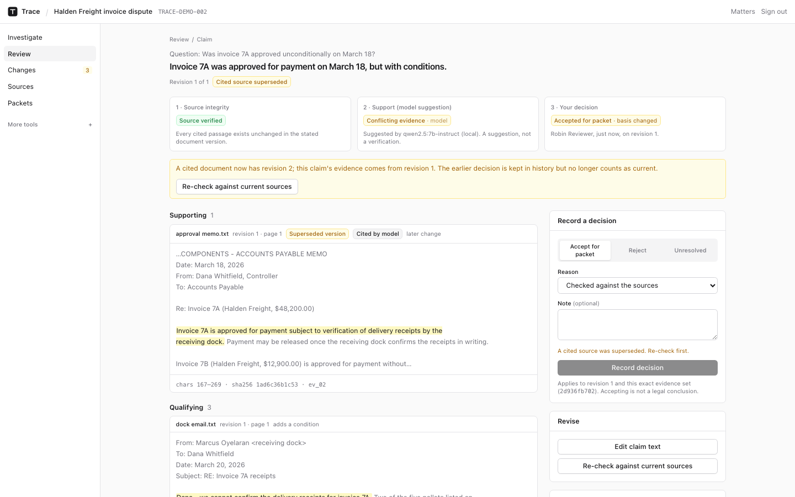
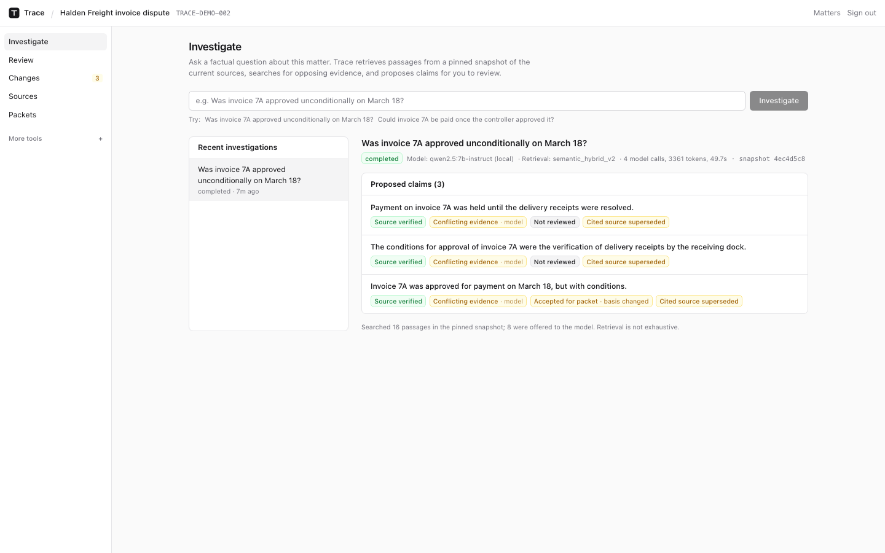
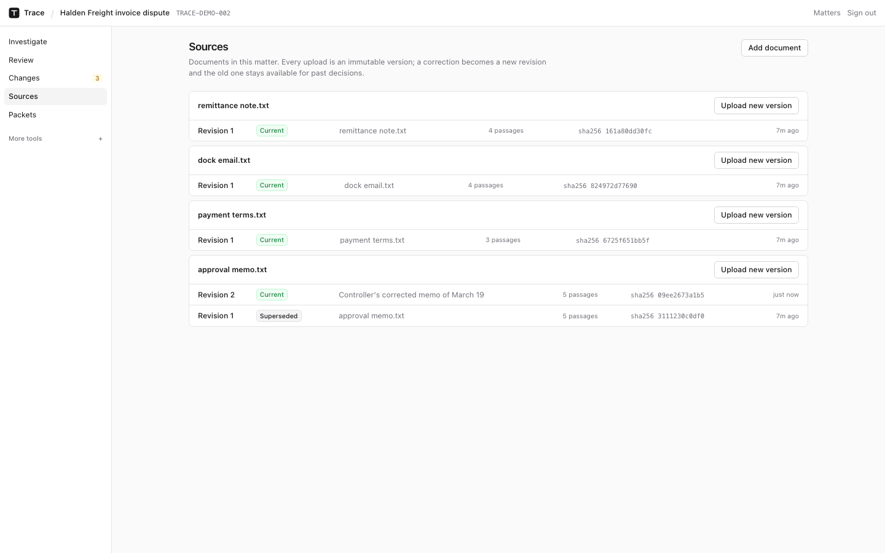

# Trace

**Evidence review that keeps track of which version of which document a finding rests on.**

Trace proposes factual claims from a matter's documents, shows the passages for *and against*
each one, and records a reviewer's decision against the exact source versions they saw. When a
cited document is corrected, the old decision stays in history but is flagged and cannot pass
for a current one. It runs on your own machine with a local model; documents never leave it.



> Portfolio project with synthetic data. Not legal advice, not validated by attorneys, not
> deployed for external users. See [Known limitations](docs/KNOWN_LIMITATIONS.md).

## Why

A real quote can still be the wrong answer. *"Invoice 7A is approved for payment subject to
verification of delivery receipts"* is a genuine sentence; it does not support *"invoice 7A was
approved unconditionally."* Checking that a citation exists is necessary and not enough. Trace
keeps three questions apart and never merges them into one score:

| | Question | Answered by |
| --- | --- | --- |
| 1 | Does the quoted passage exist, unchanged, in this document version and matter? | Deterministic code |
| 2 | Do the passages support, qualify or contradict the claim? | A model's suggestion |
| 3 | Has a reviewer accepted this claim revision with this evidence set? | A recorded human decision |

## What it does

- **Immutable sources.** Every upload is a versioned, hashed artifact. Citations point at
  `[start, end)` offsets in a specific extraction of a specific revision. A correction becomes
  revision 2; revision 1 stays resolvable for past decisions.
- **Pinned snapshots.** Each investigation pins the set of current versions it searched, so it
  can be reconstructed later and is unaffected by uploads during the run.
- **Counterevidence search.** After claims are proposed, a second search looks specifically for
  passages that qualify or reverse them (conditions, holds, corrections, negations).
- **Race-safe review.** Decisions carry the expected revision, evidence digest and review
  sequence; a stale browser tab gets a conflict instead of overwriting. Reviews are append-only.
- **Evidence drift.** Publishing a new version of a cited document marks dependent claims
  *source superseded*; a possibly relevant new document raises a cautious *may matter* alert.
- **Evidence packets.** JSON manifest, findings, Markdown and checksums built from stored records;
  packets never change after creation.
- **Local by default.** OpenAI-compatible client for Ollama, llama.cpp or vLLM. A hosted provider
  refuses to start until you acknowledge that passages will leave the machine.

<p>
  
  
</p>

## Install

Requirements: Docker Desktop. For real local inference, [Ollama](https://ollama.com/download)
(about 5 GB of models; 16 GB RAM recommended).

```bash
git clone https://github.com/vidithsalla/trace.git
cd trace
ollama serve &          # optional: skip to use the labeled mock model
./install.sh            # Windows: .\install.ps1
```

The installer writes a `.env` with generated secrets, pulls `qwen2.5:7b-instruct` and
`all-minilm:l6-v2` if Ollama is running, builds the containers, and loads two synthetic demo
matters. Then open the printed URL and sign in as `reviewer@trace.local` / `trace-demo-password`.

```bash
./trace.sh stop | start | status | logs | uninstall
```

Only the web UI is published, and only on `127.0.0.1`. Walk-through: [docs/DEMO.md](docs/DEMO.md).

## Results

Measured on a small synthetic dispute written for this project (5 end-to-end questions,
18 hand-labeled claim/passage pairs, author-labeled, no held-out split). These numbers show the
mechanism, not accuracy on real matters. Full tables and failure analysis: [RESULTS.md](RESULTS.md).

| Check | Deterministic mock | Local `qwen2.5:7b-instruct` |
| --- | --- | --- |
| Support labels correct on fixed pairs | 9 / 18 | 16 / 18 |
| Unsafe "supports" on non-supporting pairs | 2 / 12 | 0 / 12 |
| End-to-end claims with verified sources | 5 / 5 | 11 / 11 |
| Unanswerable question answered as supported | yes (flagged) | no ("not established") |
| Opposing passages reaching the reviewer (lexical retrieval, model-independent) | 4/4 with the counterevidence search, 3/4 without | same |
| Accepted claim flagged after its source was corrected (deterministic) | 1 / 1 | same |

The most useful finding was a failure: the first local-model version abstained on every question
because of JSON field order under constrained decoding. The fix is in RESULTS.md.

## Engineering notes

- **Stack:** Next.js 15, FastAPI, PostgreSQL 16 + pgvector, Redis + Dramatiq, filesystem object
  storage, Ollama. All in Docker Compose with lockfiles.
- **Matter isolation** is enforced three times: route membership checks, `matter_id` filters in
  SQL before any text is read, and composite `(matter_id, id)` foreign keys.
- **Immutability** of published text, offsets, claim revisions, evidence and review events is
  enforced by database triggers, not only application code.
- **Tests:** 114 API tests (pytest against real Postgres) including a threaded race between two
  reviewers, crash-before-commit ingestion, cross-matter access attempts, prompt injection, and
  packet tampering. CI runs them on every push without any model credentials.

Read more: [Architecture](docs/ARCHITECTURE_V3.md) · [Security](SECURITY.md) ·
[Known limitations](docs/KNOWN_LIMITATIONS.md) · [Evaluation](evals/README.md)

## Development

```bash
make up                 # stack with API/Postgres/Redis also published on localhost
make test-docker        # API tests against the running stack
make lint-docker        # ruff
make web-check          # typecheck + production build
make test-real-model    # opt-in: real Ollama smoke test
make eval-v3 ARGS="--engines mock,local --profiles all"
```

Earlier versions of Trace (grounded Q&A, chronology, entities, contradictions, issue memos) are
still available under **More tools** in each matter, running on a deterministic engine.

## License

No license file yet; all rights reserved by the author until one is added.
