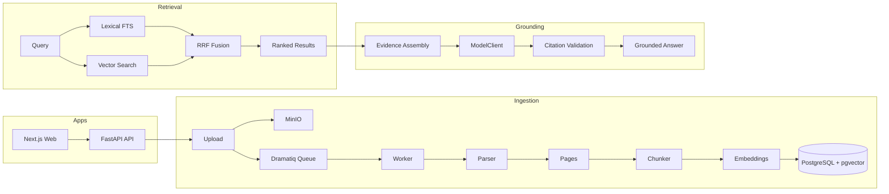

# Trace - Grounded Legal RAG with Citation Validation

A production-grade retrieval-augmented generation pipeline for legal document analysis, featuring hybrid search, deterministic citation validation, and matter-scoped evidence isolation.


## What This Project Does

Trace ingests legal documents across PDF, DOCX, XLSX, CSV, TXT, and image inputs, then parses them into page-aware chunks and indexes them in PostgreSQL with pgvector. Users search the corpus through hybrid retrieval: Postgres full-text search, vector similarity, and reciprocal-rank fusion. AI workflows generate grounded answers, chronologies, entity profiles, contradiction reports, and issue memos, with material claims validated against source text. Every document, chunk, query, AI run, citation, export, and audit record is scoped to one matter.

## Why This Is Not A Toy RAG App

Trace treats retrieval, grounding, access control, and evaluation as first-class system concerns. The core loop is not "send documents to a chatbot"; it is upload, parse, chunk, embed, retrieve, assemble evidence, generate structured output, validate citations, persist AI runs, expose audit records, and link every material answer back to source pages.

## Key Technical Highlights

- **Hybrid Retrieval with RRF**: Combines lexical search using Postgres `tsvector` with vector search using pgvector cosine similarity, merged through reciprocal-rank fusion. The default local provider is deterministic hash embeddings for lightweight development; enabling `TRACE_EMBEDDING_PROVIDER=sentence_transformer` adds semantic recall with a CPU-friendly sentence-transformer model.
- **Deterministic Citation Validation**: Post-generation validation cross-references every LLM citation against source chunks. Quoted text must exist in source material. Zero valid citations returns insufficient evidence; one citation returns low confidence; hallucinated references are not surfaced as trusted evidence.
- **Matter-Scoped Isolation**: Every chunk, query, AI run, citation, export, and audit row belongs to exactly one matter. Matter isolation is enforced through route guards, service checks, SQL filters, citation validation, and regression tests.
- **6 AI Workflows**: Grounded Q&A, chronology builder, entity summarizer, contradiction finder, issue memo generator, and citation checker use typed schemas, prompt templates, persistence, and audit coverage.
- **Multi-Format Document Ingestion**: PDF via PyMuPDF, DOCX via python-docx, XLSX via openpyxl, CSV, TXT, and image/OCR hooks. Dramatiq and Redis run asynchronous ingestion with status lifecycle tracking.
- **Evidence Trust Loop**: Search hit to source page to quote context to viewer deep-link. Citations from AI workflows can be verified from the source document page.
- **Eval Harness**: 4 corpora, Acme plus 3 regression packs, cover concept coverage, citation validity, contradiction precision, chronology completeness, semantic embedding provider behavior, and memo section coverage. The API suite currently has 56 automated tests across 12 test files.
- **Private Deployment Shape**: Model inference is abstracted behind `ModelClient`, with `MockModelClient` as the local default and `OpenAICompatibleModelClient` for private/self-hosted targets. Local development requires no GPU.

## Architecture



Documents flow through ingestion: parse, chunk, embed, and index. Retrieval runs lexical and vector search paths in parallel, then merges results with reciprocal-rank fusion. AI workflows assemble evidence, generate structured output, and post-validate citations against source text before returning answers.

## Tech Stack

| Layer | Technology |
|-------|------------|
| Frontend | Next.js 15, TypeScript |
| Backend | FastAPI, Python 3.12 |
| Database | PostgreSQL 16 + pgvector |
| Object Storage | MinIO, S3-compatible |
| Task Queue | Dramatiq + Redis 7 |
| Search | Postgres FTS + pgvector cosine + RRF |
| Embeddings | Default hash provider, optional sentence-transformer provider |
| Auth | Argon2 hashing, API-owned session cookies |
| Containerization | Docker Compose |
| Testing | pytest, 56 tests, pnpm typecheck |

## RAG Pipeline

### Ingestion

Multipart upload streams files to MinIO in bounded chunks while computing SHA-256. The API enqueues a Dramatiq job with the document ID only, so raw bytes do not travel through Redis. The worker parses each file with format-specific parsers, persists page-level raw and normalized text, chunks at roughly 800 tokens with 150-token overlap while preserving page boundaries, embeds each chunk, and stores vectors in pgvector.

### Retrieval

Trace runs two retrieval paths: Postgres full-text search with `to_tsvector`, `plainto_tsquery`, and `ts_rank_cd`, plus pgvector cosine similarity against the query embedding. Results are merged with reciprocal-rank fusion using `k=60`. Every retrieval query enforces matter scope before ranking and supports filters for document IDs, file types, document types, date ranges, entity names, and source names.

### Embeddings

The default `LocalHashEmbeddingClient` produces deterministic 384-dimensional vectors for lightweight development and CI. Semantic mode is opt-in with `TRACE_EMBEDDING_PROVIDER=sentence_transformer` and `sentence-transformers/all-MiniLM-L6-v2`, which preserves the existing 384-dimensional pgvector schema. Documents must be re-ingested or re-embedded after changing providers.

### Grounding

Model output is post-processed through deterministic citation validation. Every cited chunk, document, and page must exist in the queried matter, and every quoted string must match source text. If no citations validate, Trace returns insufficient evidence instead of an unsupported answer. Single-citation answers are low confidence; high-confidence factual answers require corroborating validated citations when available.

## AI Workflows

| Workflow | What It Does |
|----------|--------------|
| Grounded Q&A | Matter-scoped question answering with validated citations and confidence scoring |
| Chronology Builder | Citation-backed timeline events with date normalization and dispute flags |
| Entity Summarizer | Evidence-backed profiles for people, organizations, and key concepts with mention tracing |
| Contradiction Finder | Conflicting claims with side-by-side evidence and severity labels |
| Issue Memo Generator | First-pass legal memos with supporting facts, contrary facts, gaps, and next-review recommendations |
| Citation Checker | Deterministic validation of LLM citations against source material |

## Project Structure

```text
trace/
├── apps/
│   ├── web/          # Next.js 15 frontend
│   ├── api/          # FastAPI backend: routes, services, models, schemas, tests
│   └── worker/       # Dramatiq async worker
├── packages/
│   ├── types/        # Shared TypeScript contracts
│   └── ui/           # Shared UI primitives
├── infra/
│   ├── compose/      # Docker Compose core stack plus model/OCR overlays
│   ├── docker/       # Dockerfiles
│   └── scripts/      # Boot and verification scripts
├── seed_data/        # Synthetic source documents
├── seed_truth/       # Truth maps and eval fixtures
├── docs/             # Public architecture, local dev, schema, and design docs
└── ROADMAP.md        # 13-phase system design and execution tracker
```

## Quick Start

1. Clone the repo and copy `.env.example` to `.env`.
2. Run `make up` to boot the core stack: web, API, worker, Postgres, Redis, and MinIO.
3. Run `make seed` to load the Acme Industrial v. Northshore Supply demo matter.
4. Open `http://localhost:3000` and sign in with seeded credentials from `docs/local_dev.md`.
5. Run `make eval` to execute the Acme eval harness against the seeded data.

### Available Commands

| Command | Description |
|---------|-------------|
| `make up` | Boot the lightweight core stack |
| `make up-full` | Boot with model and OCR overlays |
| `make down` | Stop all services |
| `make seed` | Fast demo bootstrap with processed artifacts |
| `make seed-raw` | Raw-ingestion seed flow |
| `make test` | Run the local API pytest suite when Python dependencies are installed |
| `make eval` | Run the Acme MVP eval |
| `make eval-all` | Run Acme plus all regression corpora |

## End-to-End Demo

1. Sign in as a seeded attorney.
2. Open the Acme Industrial v. Northshore Supply matter.
3. Browse uploaded documents with ingest status badges.
4. Search for `defect knowledge before shipment` and inspect snippets and scores.
5. Click a result to open the exact source page in the document viewer.
6. Ask `What evidence suggests Northshore knew of the defect before shipment?`
7. Click a citation to verify it against the source document.
8. Generate a chronology and inspect entity pages.
9. Run contradiction analysis and generate an issue memo.
10. Export an artifact and view the AI run record plus audit trail.

## Design Decisions

See [docs/pre_build_decisions.md](./docs/pre_build_decisions.md) for architecture rationale, including why pgvector was chosen over a dedicated vector database, why model inference is abstracted for private deployment, why citation validation is conservative, and why hybrid retrieval is used instead of pure vector search.

## Extending To Full Product

See [ROADMAP.md](./ROADMAP.md) for the complete 13-phase system design. Phases 0-12, from local platform through semantic retrieval upgrade, are implemented and verified. Phase 13 documents the future product launch path: public landing page, deployment options, invite-only access, and external-user onboarding.

## Roadmap Overview

| Phase | Description | Status |
|-------|-------------|--------|
| 0 | Repo, Docker, local platform | Verified |
| 1 | Auth, orgs, matters, RBAC | Verified |
| 2 | Upload and ingestion skeleton | Verified |
| 3 | Parsing, OCR, chunks, embeddings, search | Verified |
| 4 | Document viewer and citation trust loop | Verified |
| 5 | Grounded Q&A with citation validation | Verified |
| 6 | Chronology builder | Verified |
| 7 | Entity and witness layer | Verified |
| 8 | Contradiction finder | Verified |
| 9 | Issue memo generator | Verified |
| 10 | Exports, audit, seed modes, evals | Verified |
| 11 | Eval breadth with regression corpora | Verified |
| 12 | Semantic retrieval upgrade | Verified |
| 13 | Product launch path | Designed |
