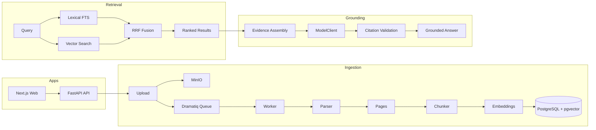

# Trace - Sovereign Discovery Copilot

A production-grade document analysis system with grounded AI workflows for legal discovery-style evidence review. Trace ingests matter-scoped documents, builds a searchable evidence corpus, and runs structured AI workflows that must cite and validate source material before results are trusted.

The project is designed as a production-style monorepo rather than a chatbot demo: it includes authentication, matter isolation, async ingestion, hybrid retrieval, citation validation, audit trails, exports, seed data, and regression tests.


## What This Project Does

Trace lets users upload and analyze evidence within isolated legal matters. It parses files into page-aware chunks, indexes them with PostgreSQL full-text search and pgvector embeddings, retrieves relevant evidence, and runs grounded workflows for Q&A, chronologies, entities, contradictions, and issue memos.

Every material AI output is tied back to source documents through validated citations. If the system cannot validate evidence for an answer, it returns insufficient evidence rather than presenting unsupported claims.

## Why This Is Not A Toy AI Project

- **Hybrid retrieval, not simple vector search**: Search combines Postgres full-text search, pgvector similarity, metadata filters, and reciprocal-rank fusion.
- **Deterministic citation validation**: LLM citations are checked against stored source chunks; hallucinated quotes are not surfaced as trusted evidence.
- **Matter-scoped isolation**: Documents, chunks, retrieval results, AI runs, citations, exports, and audit logs are all scoped to exactly one matter.
- **Full evidence pipeline**: The system implements ingestion, parsing, chunking, embedding, retrieval, evidence assembly, model execution, validation, persistence, and viewer deep links.
- **Workflow persistence and auditability**: AI runs, citations, chronology events, memos, exports, and audit records are persisted rather than treated as disposable chat messages.
- **Local-first but production-shaped**: The default stack runs without a GPU or external LLM, while model and embedding providers are abstracted for private/self-hosted deployment.

## Key Technical Highlights

- **Multi-format ingestion**: PDF, DOCX, XLSX, CSV, TXT, and image/OCR hooks with async processing through Dramatiq and Redis.
- **Object storage boundary**: Multipart uploads stream to MinIO while computing SHA-256; raw bytes do not travel through Redis job payloads.
- **Hybrid retrieval with RRF**: Lexical ranking and vector ranking are merged with reciprocal-rank fusion using `k=60`.
- **Embedding provider abstraction**: Deterministic 384-dimensional hash embeddings are the default for lightweight CI and local development; `TRACE_EMBEDDING_PROVIDER=sentence_transformer` enables `sentence-transformers/all-MiniLM-L6-v2`.
- **Grounded AI workflow layer**: Q&A, chronology, entity summaries, contradiction reports, issue memos, and citation checks use typed schemas, persistence, and validation.
- **Evidence trust loop**: Search results and AI citations deep-link to source document pages with local text context for verification.
- **Regression coverage**: The API suite has 56 tests across auth, ingestion, retrieval, viewer, AI workflows, exports, evals, and semantic embedding provider behavior.

## Key Design Decisions

- **PostgreSQL + pgvector instead of a separate vector database**: Trace keeps relational records, matter scoping, lexical search, vector search, citations, and audit data in one transactional system. For this MVP scale, Postgres reduces operational complexity while still supporting vector similarity and full-text search.
- **Hybrid retrieval instead of pure semantic retrieval**: Legal evidence often depends on exact names, dates, clauses, invoice IDs, and quoted language. Full-text search preserves exact-match precision, while vector search improves paraphrase recall. Reciprocal-rank fusion lets both signals contribute.
- **Strict citation validation instead of trusting model output**: The model can propose an answer, but source validation determines whether it is safe to show. Quoted text must match source material, cited chunks must belong to the matter, and unsupported answers degrade to insufficient evidence or low confidence.
- **Matter isolation at the data layer**: Matter boundaries are enforced through database relationships, route guards, service checks, query filters, citation validation, and tests. This prevents cross-matter leakage from becoming a UI-only concern.
- **Mock model by default**: Local development uses `MockModelClient` so the stack can run on constrained hardware. The `OpenAICompatibleModelClient` keeps the production path open for self-hosted or private model endpoints.

## Architecture

Trace is organized around three pipeline stages. Ingestion turns uploaded files into normalized pages, chunks, and embeddings. Retrieval searches the matter-scoped corpus through lexical and vector paths, then fuses ranked candidates. Grounding assembles evidence for AI workflows and validates returned citations before persisting user-visible results.



## Tech Stack

| Layer | Technology |
|-------|------------|
| Frontend | Next.js 15, TypeScript |
| Backend | FastAPI, Python 3.12 |
| Database | PostgreSQL 16 + pgvector |
| Object Storage | MinIO, S3-compatible |
| Task Queue | Dramatiq + Redis 7 |
| Search | Postgres FTS + pgvector cosine + RRF |
| Embeddings | Default hash provider, optional sentence-transformer provider |
| Auth | Argon2 hashing, API-owned session cookies |
| Containerization | Docker Compose |
| Testing | pytest, 56 tests, pnpm typecheck |

## Document Analysis Pipeline

### Ingestion

Multipart upload streams files to MinIO in bounded chunks while computing SHA-256. The API enqueues a Dramatiq job with the document ID only, so raw bytes do not travel through Redis. The worker parses each file with format-specific parsers, persists page-level raw and normalized text, chunks at roughly 800 tokens with 150-token overlap while preserving page boundaries, embeds each chunk, and stores vectors in pgvector.

### Retrieval

Trace runs two retrieval paths: Postgres full-text search with `to_tsvector`, `plainto_tsquery`, and `ts_rank_cd`, plus pgvector cosine similarity against the query embedding. Results are merged with reciprocal-rank fusion using `k=60`. Every retrieval query enforces matter scope before ranking and supports filters for document IDs, file types, document types, date ranges, entity names, and source names.

### Embeddings

The default `LocalHashEmbeddingClient` produces deterministic 384-dimensional vectors for lightweight development and CI. Semantic mode is opt-in with `TRACE_EMBEDDING_PROVIDER=sentence_transformer` and `sentence-transformers/all-MiniLM-L6-v2`, which preserves the existing 384-dimensional pgvector schema. Documents must be re-ingested or re-embedded after changing providers.

### Grounding

Model output is post-processed through deterministic citation validation. Every cited chunk, document, and page must exist in the queried matter, and every quoted string must match source text. If no citations validate, Trace returns insufficient evidence instead of an unsupported answer. Single-citation answers are low confidence; high-confidence factual answers require corroborating validated citations when available.

## AI Workflows

| Workflow | What It Does |
|----------|--------------|
| Grounded Q&A | Matter-scoped question answering with validated citations and confidence scoring |
| Chronology Builder | Citation-backed timeline events with date normalization and dispute flags |
| Entity Summarizer | Evidence-backed profiles for people, organizations, and key concepts with mention tracing |
| Contradiction Finder | Conflicting claims with side-by-side evidence and severity labels |
| Issue Memo Generator | First-pass legal memos with supporting facts, contrary facts, gaps, and next-review recommendations |
| Citation Checker | Deterministic validation of LLM citations against source material |

## Project Structure

```text
trace/
├── apps/
│   ├── web/          # Next.js 15 frontend
│   ├── api/          # FastAPI backend: routes, services, models, schemas, tests
│   └── worker/       # Dramatiq async worker
├── packages/
│   ├── types/        # Shared TypeScript contracts
│   └── ui/           # Shared UI primitives
├── infra/
│   ├── compose/      # Docker Compose core stack plus model/OCR overlays
│   ├── docker/       # Dockerfiles
│   └── scripts/      # Boot and verification scripts
├── seed_data/        # Synthetic source documents
├── seed_truth/       # Truth maps and eval fixtures
├── docs/             # Public architecture, local dev, schema, and design docs
└── ROADMAP.md        # 13-phase system design and execution tracker
```

## Quick Start

1. Clone the repo and copy `.env.example` to `.env`.
2. Run `make up` to boot the core stack: web, API, worker, Postgres, Redis, and MinIO.
3. Run `make seed` to load the Acme Industrial v. Northshore Supply demo matter.
4. Open `http://localhost:3000` and sign in with seeded credentials from `docs/local_dev.md`.
5. Run `make eval` to execute the Acme eval harness against the seeded data.

### Available Commands

| Command | Description |
|---------|-------------|
| `make up` | Boot the lightweight core stack |
| `make up-full` | Boot with model and OCR overlays |
| `make down` | Stop all services |
| `make seed` | Fast demo bootstrap with processed artifacts |
| `make seed-raw` | Raw-ingestion seed flow |
| `make test` | Run the local API pytest suite when Python dependencies are installed |
| `make eval` | Run the Acme MVP eval |
| `make eval-all` | Run Acme plus all regression corpora |

## End-to-End Demo

1. Sign in as a seeded attorney.
2. Open the Acme Industrial v. Northshore Supply matter.
3. Browse uploaded documents with ingest status badges.
4. Search for `defect knowledge before shipment` and inspect snippets and scores.
5. Click a result to open the exact source page in the document viewer.
6. Ask `What evidence suggests Northshore knew of the defect before shipment?`
7. Click a citation to verify it against the source document.
8. Generate a chronology and inspect entity pages.
9. Run contradiction analysis and generate an issue memo.
10. Export an artifact and view the AI run record plus audit trail.

## What I Would Improve Next

- **Stronger embedding models**: `all-MiniLM-L6-v2` is a practical CPU-friendly baseline, but legal retrieval would benefit from stronger domain-aware or self-hosted embedding models.
- **Reranking layer**: Add a cross-encoder or lightweight reranker after first-stage retrieval to improve ordering of evidence candidates.
- **HNSW indexing**: Add pgvector HNSW indexes for larger corpora once the dataset size justifies approximate nearest-neighbor tuning.
- **Larger eval datasets**: Expand beyond the current synthetic truth packs with more varied document formats, noisy OCR cases, and adversarial citation checks.
- **More robust OCR path**: The OCR service boundary exists, but production usage would need more extensive scanned-document evaluation and operational hardening.
- **Deployment hardening**: Add production deployment templates, secret management, backup/restore flows, and observability dashboards.

## Design Docs

- [docs/pre_build_decisions.md](./docs/pre_build_decisions.md): implementation defaults and architecture rationale.
- [docs/schema_and_seeds.md](./docs/schema_and_seeds.md): database schema, seed data, and truth-map expectations.
- [docs/architecture.md](./docs/architecture.md): system architecture and local topology.
- [docs/local_dev.md](./docs/local_dev.md): local setup, Docker Compose usage, and lightweight development mode.
- [ROADMAP.md](./ROADMAP.md): 13-phase execution roadmap and verification tracker.

## Extending To Full Product

Trace is currently a public portfolio project and production-style local system. Phase 13 in [ROADMAP.md](./ROADMAP.md) documents future product launch work: public landing page, deployment options, invite-only access, and external-user onboarding.

## Roadmap Overview

| Phase | Description | Status |
|-------|-------------|--------|
| 0 | Repo, Docker, local platform | Verified |
| 1 | Auth, orgs, matters, RBAC | Verified |
| 2 | Upload and ingestion skeleton | Verified |
| 3 | Parsing, OCR, chunks, embeddings, search | Verified |
| 4 | Document viewer and citation trust loop | Verified |
| 5 | Grounded Q&A with citation validation | Verified |
| 6 | Chronology builder | Verified |
| 7 | Entity and witness layer | Verified |
| 8 | Contradiction finder | Verified |
| 9 | Issue memo generator | Verified |
| 10 | Exports, audit, seed modes, evals | Verified |
| 11 | Eval breadth with regression corpora | Verified |
| 12 | Semantic retrieval upgrade | Verified |
| 13 | Product launch path | Designed |
