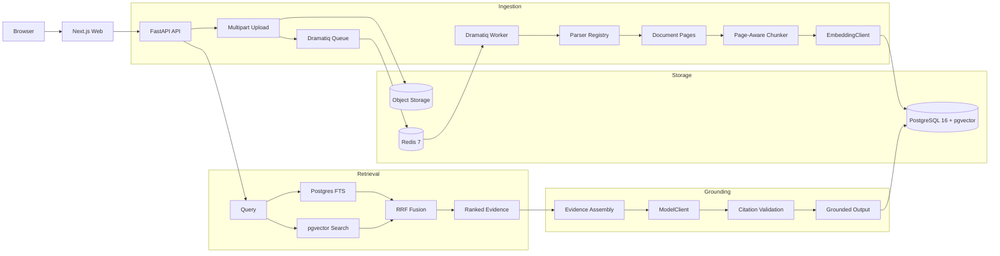

# Trace Architecture

Trace is a full-stack RAG system for legal document analysis. It combines matter-scoped document ingestion, hybrid retrieval, deterministic citation validation, structured AI workflows, export jobs, and auditability in a private deployment-oriented monorepo.

## System Overview

The system has three executable apps: a Next.js 15 frontend, a FastAPI backend, and a Dramatiq worker. PostgreSQL 16 with pgvector stores relational data and embeddings, Redis backs background jobs, and a filesystem volume (or optional S3-compatible store) holds uploaded files plus generated artifacts. The API owns auth, sessions, RBAC, matter isolation, public route contracts, AI workflow orchestration, citation validation, and audit logging.

## Architecture Diagram

## RAG Pipeline

### Ingestion

Uploads stream to object storage while the API computes SHA-256 and creates document plus ingest-job rows. The queue payload contains the document ID only. The worker fetches the object from storage, parses it, persists page records, creates chunks, embeds chunk text, stores vectors in pgvector, extracts lightweight entity candidates, updates ingest status, and records audit events.

### Parsing

The parser registry resolves file handlers by MIME type and extension. PDFs use PyMuPDF. DOCX uses python-docx. XLSX uses openpyxl. CSV uses Python's csv module. TXT uses plain text decoding. Image and scanned-PDF paths route through the OCR abstraction, which defaults to disabled in the lightweight local stack and records visible OCR status instead of pretending extraction succeeded.

### Chunking

Chunking preserves page boundaries and defaults to roughly 800 tokens with 150-token overlap. Chunk metadata keeps page number, word offsets, target size, and overlap details so citations can deep-link back to the source page and surrounding context.

### Embeddings

`EmbeddingClient` is pluggable. The default `LocalHashEmbeddingClient` creates deterministic 384-dimensional vectors for CI, tests, and constrained local development. Semantic mode uses `SentenceTransformerEmbeddingClient` with `sentence-transformers/all-MiniLM-L6-v2` behind `TRACE_EMBEDDING_PROVIDER=sentence_transformer`. Both providers preserve the existing 384-dimensional pgvector column. Documents must be re-ingested or re-embedded after switching providers.

### Retrieval

Retrieval combines Postgres full-text search with pgvector cosine similarity. The lexical path uses `to_tsvector`, `plainto_tsquery`, and `ts_rank_cd`; the vector path ranks chunks by cosine similarity against the query embedding. Reciprocal-rank fusion merges both rankings with `k=60`. Candidate selection enforces matter scope before ranking.

### Grounding And Citation Validation

AI workflows assemble evidence packs from matter-scoped retrieval results. After generation, Trace validates that every cited document, chunk, and page exists in the same matter and that quoted text appears in source material. Zero validated citations returns insufficient evidence. One citation produces low confidence. High-confidence factual answers require corroborating citations when available.

## AI Workflows

Trace standardizes workflow contracts as typed inputs, typed outputs, prompt templates, validation, persistence, and audit coverage:

- `grounded_qa_v1`
- `chronology_builder_v1`
- `entity_summary_v1`
- `contradiction_finder_v1`
- `issue_memo_v1`
- `citation_check_v1`

## Data Model

Core tables include organizations, users, matters, matter_members, documents, document_pages, document_chunks, ingest_jobs, ai_runs, citations, events, event_citations, entities, entity_mentions, memos, export_jobs, audit_logs, and saved_searches. Every retrieval result, AI run, memo, citation, export, entity, event, and chunk is tied to one matter.

## Security Model

Passwords are hashed with Argon2. The API owns session cookies and exposes `/auth/login`, `/auth/logout`, and `/me`. Users belong to organizations, and matter access is controlled by membership roles: admin, attorney, reviewer, and read_only. Matter isolation is enforced through route dependencies, service-level checks, SQL filters, and citation validation.

## Design Decisions

See [pre_build_decisions.md](./pre_build_decisions.md) for detailed rationale. The short version:

- pgvector keeps relational state and vector search in one database, avoiding synchronization between a primary database and a separate vector store.
- Self-hosted/private model integration remains the deployment target, while local development uses mock model behavior to stay lightweight.
- Citation validation is conservative because unsupported legal answers are worse than no answer.
- Hybrid retrieval is used because legal documents need exact terminology matching and semantic recall.
- Default hash embeddings keep tests and local development deterministic; opt-in sentence-transformer embeddings provide real semantic retrieval when the environment supports it.
